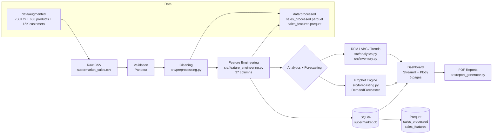

# 🪲✨ Lucciola — Illuminate your data.

> **Supermarket Business Intelligence, beautifully executed.** Turn half a million raw transactions into executive-ready insights, live forecasts, and natural-language answers — in under five minutes.

**Lucciola** *(Italian for "firefly")* is a production-grade **Python / Streamlit / Plotly / Prophet** BI platform for supermarket retail. It synthesizes, cleans, enriches, analyzes, forecasts, and presents retail operations end-to-end — from synthetic CSVs to a dark-themed interactive dashboard and one-click PDF briefings.


[](https://www.python.org/)
[](https://streamlit.io/)
[](https://facebook.github.io/prophet/)
[](LICENSE)
[](.github/workflows/ci.yml)
[](tests/)
[](Dockerfile)
[](#testing--cicd)

---

## 😤 The Problem

Supermarkets generate **hundreds of thousands of transactions** across branches, categories, and payment rails every year. Managers drown in CSVs — and Excel can't spot a seasonal stockout, a churn signal, or a demand surge until it's already lost revenue.

> **Lucciola solves it:** one command creates realistic data, validates and enriches it, and drops it into a live dashboard, a Prophet forecast, and a boardroom PDF. From raw to insight in minutes, not days.

---

## 💡 What Lucciola Does

| | Capability | Detail |
|---|---|---|
| 📊 | **Sales Analytics** | Daily / weekly / monthly revenue trends, hourly traffic, payment & branch breakdowns, moving averages |
| 👥 | **Customer Intelligence** | RFM scoring, rule-based segments (Champions · Loyal · At-Risk · Lost), repeat-rate & CLV |
| 📦 | **Inventory Optimization** | ABC analysis, safety-stock (95% service-level Z=1.65), lead-time reorder alerts |
| 🔮 | **Demand Forecasting** | Prophet-powered with 90% confidence bands, anomaly flags & trend / weekly seasonality decomposition |
| 🤖 | **AI Business Assistant** | Natural-language data queries — offline, rule-based, grounded in SQLite (27 query templates) |
| 📄 | **Automated Reports** | One-click executive PDF via `fpdf2` + matplotlib charts |
| 🐳 | **One-Command Deploy** | `docker-compose up --build` → http://localhost:8501 |
| ✅ | **CI/CD Pipeline** | GitHub Actions on every push (Python 3.10 & 3.11, flake8 + pytest) |

---

## 🏗 Architecture



> **Data flow in one line:** `generate_all()` creates `data/augmented/*.csv` → `run_preprocessing_pipeline()` cleans to `sales_processed.parquet` → `run_feature_engineering()` enriches to `sales_features.parquet` + `database/supermarket.db` → every page reads from `theme.load_data()`.

---

## 🧰 Tech Stack

| Category | Technology | Version | Purpose |
|---|---|---|---|
| **Core** | Python | 3.10+ | Runtime (see `setup.py` `python_requires`) |
| | pandas | 2.1.4 | DataFrames everywhere |
| | numpy | 1.26.2 | Vectorized generation & analytics |
| | pyarrow | 14.0.2 | Parquet I/O |
| **Data** | pandera | 0.18.0 | Schema validation |
| | faker | 21.0.0 | Synthetic customers & products |
| | openpyxl | 3.1.2 | Excel support |
| **Viz** | plotly | 5.18.0 | Interactive charts (all dashboard pages) |
| | matplotlib | 3.8.2 | Static PDF-report charts |
| | statsmodels | 0.14.1 | Seasonal decomposition |
| **Dashboard** | streamlit | 1.29.0 | App shell, `dashboard/app.py` |
| | kaleido | 0.2.1 | Image export (CI note: disabled, report uses matplotlib) |
| **Forecasting** | prophet | 1.5.0 | `DemandForecaster` / `CategoryForecaster` |
| **Database** | sqlalchemy | 2.0.23 | SQLite ORM |
| | SQLite | via `database/schema.sql` | `sales` · `products` · `customers` |
| **DevOps** | Docker | `python:3.10-slim` | `Dockerfile` + `docker-compose.yml` |
| | GitHub Actions | `ci.yml` | Lint + test matrix `3.10` / `3.11` |
| **Testing** | pytest | 7.4.3 | 7 test files, 60+ tests |
| **Logging** | loguru | 0.7.2 | Structured logging |
| | python-dotenv | 1.0.0 | `.env` config |

<details>
<summary>📦 Full requirements.txt</summary>

```txt
pandas==2.1.4
numpy==1.26.2
pyarrow==14.0.2
matplotlib==3.8.2
plotly==5.18.0
scikit-learn==1.3.2
mlxtend==0.23.0
xgboost==2.0.3
prophet==1.5.0
streamlit==1.29.0
sqlalchemy==2.0.23
pandera==0.18.0
multimethod==1.9.1
openpyxl==3.1.2
joblib==1.3.2
faker==21.0.0
shap==0.44.0
pytest==7.4.3
loguru==0.7.2
fpdf2==2.7.6
python-dotenv==1.0.0
requests==2.31.0
kaleido==0.2.1
statsmodels==0.14.1
```

> Real versions pulled straight from `requirements.txt`. `setup.py` is `ai_supermarket_bi==1.0.0`, `license=MIT`, `python_requires>=3.10`.

</details>

---

## 📁 Project Structure

```
AI_Supermarket_BI/
├── dashboard/
│   ├── app.py                 # Overview — revenue, traffic, customers, basket
│   ├── theme.py               # Lucciola Enterprise Dark design system (tokens, CSS, chart theme)
│   ├── data.py                # Shared data layer
│   └── pages/
│       ├── 1_Sales.py         # Trend / Breakdown / Distribution + Prophet toggle
│       ├── 2_Customers.py     # RFM segments, cohorts, retention heatmap
│       ├── 3_Inventory.py     # ABC, safety stock, reorder report
│       ├── 4_Forecasting.py   # Prophet forecast + decomposition + anomalies
│       └── 5_AI_Assistant.py  # BusinessAssistant chat + executive PDF trigger
├── src/
│   ├── config.py              # NUM_RECORDS, BRANCHES, TAX_RATE, paths, holidays
│   ├── data_generator.py      # generate_all() → 750K tx, 600 products, 15K customers
│   ├── data_validation.py     # Pandera schemas
│   ├── preprocessing.py       # run_preprocessing_pipeline()
│   ├── feature_engineering.py # run_feature_engineering() → 37-col enriched parquet
│   ├── analytics.py           # rfm_analysis(), product/trend_analysis(), run_full_analytics()
│   ├── inventory.py           # analyze_stock(), abc_analysis(), calculate_safety_stock()
│   ├── forecasting.py         # DemandForecaster, CategoryForecaster (Prophet)
│   ├── ai_assistant.py        # BusinessAssistant — 27 offline query templates
│   ├── report_generator.py    # generate_executive_report() → PDF via fpdf2
│   ├── visualization.py       # Shared Plotly/matplotlib helpers
│   └── logger.py              # loguru setup
├── database/
│   └── schema.sql             # sales / products / customers (SQLite) + 4 indexes
├── data/
│   ├── augmented/             # supermarket_sales.csv + products.csv + customers.csv
│   ├── processed/             # sales_processed.parquet + sales_features.parquet
│   └── raw/                   # (optional inbound)
├── tests/                     # 7 suites, 60+ tests
├── notebooks/01_EDA.ipynb     # Exploratory analysis
├── .github/workflows/ci.yml   # lint + pytest (3.10 / 3.11)
├── .env.example               # Env template (5 vars)
├── Dockerfile                 # python:3.10-slim → streamlit run :8501
├── docker-compose.yml         # supermarket-bi : 8501:8501 + persisted volumes
├── Makefile                   # 14 targets (install → all)
├── setup.py                   # ai_supermarket_bi 1.0.0, MIT
├── audit.py                   # 9-point 100% ship-ready check
└── README.md
```

<details>
<summary>🌲 Full tree (including generated artefacts)</summary>

```bash
.
├── InstallationLog.txt
├── Dockerfile
├── docker-compose.yml
├── requirements.txt
├── setup.py
├── Makefile
├── audit.py
├── .env.example
├── .streamlit/
├── .github/workflows/ci.yml
├── dashboard/
│   ├── app.py
│   ├── theme.py
│   ├── data.py
│   └── pages/1_Sales.py … 5_AI_Assistant.py
├── src/  (13 Python files)
├── database/schema.sql
├── data/augmented/
├── data/processed/
├── tests/
│   ├── test_preprocessing.py
│   ├── test_data_validation.py
│   ├── test_analytics.py
│   ├── test_inventory.py
│   ├── test_forecasting.py
│   ├── test_dashboard_helpers.py
│   └── test_integration_fix.py
├── notebooks/01_EDA.ipynb
├── scripts/audit_data.py  run_pipeline.py
└── reports/
```

</details>

---

## 🚀 Quick Start

### Prerequisites

* **Python 3.10+** (3.10 or 3.11 — CI tests both)
* `pip`, `git` — Docker optional

### 1 — Local (copy-paste)

```bash
git clone https://github.com/Euphoriticjenni/AI_Supermarket_BI.git
cd AI_Supermarket_BI

python -m venv .venv
# Windows: .venv\Scripts\activate
source .venv/bin/activate

pip install -r requirements.txt
pip install prophet          # already in requirements, but safe to force
```

### 2 — Generate data (≈ 750K rows, ~30s)

```python
python -c "from src.data_generator import generate_all; generate_all()"
```

> Creates `data/augmented/supermarket_sales.csv` (150 MB) + `products.csv` + `customers.csv` and seeds `database/supermarket.db`. Respects `NUM_RECORDS` from `src/config.py` (default `500_000`, generator default `750_000`).

### 3 — Full pipeline (optional — dashboard reads augmented directly)

```bash
python -c "from src.preprocessing import run_preprocessing_pipeline; run_preprocessing_pipeline()"
python -c "import pandas as pd; from src.feature_engineering import run_feature_engineering; df = pd.read_parquet('data/processed/sales_processed.parquet'); run_feature_engineering(df)"
python -c "import pandas as pd; from src.analytics import run_full_analytics; df = pd.read_parquet('data/processed/sales_features.parquet'); run_full_analytics(df)"
```

### 4 — Launch the dashboard

```bash
streamlit run dashboard/app.py
```

Expected:

```txt
  You can now view your Streamlit app in your browser.

  Local URL: http://localhost:8501
```

### 🐳 Docker alternative

```bash
docker-compose up --build
# → http://localhost:8501  (container: supermarket-bi, healthcheck: /_stcore/health)
```

`docker-compose.yml` mounts `./data`, `./database`, `./reports`, `./logs` so rebuilds keep state and exposes `DATABASE_PATH=/app/database/supermarket.db`.

---

## 🖥 Dashboard Pages

| Page | Key Visuals | What It Shows |
|---|---|---|
| **Overview** `dashboard/app.py` |  | 4 KPI cards + revenue sparkline · *Revenue and mix* (weekly-rolled trend + category bar) · hourly traffic · payment mix · recent 20 transactions |
| **Sales** `1_Sales.py` |  | Trend (Revenue + 7d/30d MAs + optional 30-day Prophet forecast) · category stack by month · product treemap · histogram + box distribution |
| **Customers** `2_Customers.py` |  | RFM segments · segment pie + frequency/monetary scatter · cohort retention heatmap · customer growth + forecast |
| **Inventory** `3_Inventory.py` |  | ABC class bar + stock-status pie · safety-stock table (Z=1.65) · reorder report with reorder points |
| **Forecasting** `4_Forecasting.py` |  | Horizon slider (7–180d) · historical + Prophet forecast with 90% band · trend & weekly-seasonality decomposition · anomaly table · planning notes |
| **AI Assistant** `5_AI_Assistant.py` |  | Natural-language chat, context charts (revenue + payment mix), executive PDF trigger |

> Real screenshots live in `reports/dashboard_screenshots/` (12 images). Placeholders above resolve when you export screenshots to `docs/screenshots/`.

> **Design system:** `dashboard/theme.py` — Enterprise Dark. Tokens: `BG_ROOT #09090B`, `BG_SURFACE #18181B`, `ACCENT #3B82F6`, `SUCCESS #22C55E`, Inter font, Plotly dark template, `COLORWAY` of 8 brand hues, `kpi` / `panel` / `badge` CSS components.

---

## 🔄 Data Pipeline

```bash
generate_all()  →  run_preprocessing_pipeline()  →  run_feature_engineering()  →  run_full_analytics()
     │                        │                             │                            │
     │ 750K tx × 6 lines      │ dedup, nulls,               │ 37 columns:                │ RFM + product + trend
     │ 10K customers          │ outliers, dtypes,           │ temporal, financial,       │ + inventory + forecast
     │ 600 products           │ schema (Pandera)            │ rolling, lag, basket       │
     └─ data/augmented/       └─ sales_processed.parquet   └─ sales_features.parquet    └─ processed/*.csv
```

| Stage | Entrypoint | Function | Output |
|---|---|---|---|
| **Generate** | `src/data_generator.py` | `generate_all(seed=42, n_transactions=750_000)` → `generate_transactions()` + `generate_customers(n=15_000)` + `generate_products(n=600)` + `load_to_database()` | `data/augmented/supermarket_sales.csv` · `products.csv` · `customers.csv` · `database/supermarket.db` |
| **Preprocess** | `src/preprocessing.py` | `run_preprocessing_pipeline()` | `data/processed/sales_processed.parquet` (also `.csv`) |
| **Features** | `src/feature_engineering.py` | `run_feature_engineering(df)` | `data/processed/sales_features.parquet` (37 columns) |
| **Analytics** | `src/analytics.py` | `run_full_analytics(df)` → `rfm_analysis()` + `product_analysis()` + `trend_analysis()` | `customer_segments.csv` · `model_comparison.csv` · `detected_anomalies.csv` |
| **Inventory** | `src/inventory.py` | `run_inventory_pipeline(products_df, sales_df)` → `analyze_stock()` + `abc_analysis()` + `calculate_safety_stock()` | `abc_analysis.csv` · `reorder_report.csv` |
| **Audit** | `audit.py` | `python audit.py` (9 checks) | `100% ship-ready` verdict |

**Real scale from `src/config.py`:** Branches `Yangon / Mandalay / Naypyitaw`, product lines *Health & beauty · Electronic accessories · Home & lifestyle · Sports & travel · Food & beverages · Fashion accessories*, payments *Cash / Credit card / Ewallet*, `DATE_START 2022-01-01 → DATE_END 2023-12-31`, `TAX_RATE 5%`, `GROSS_MARGIN_PCT 4.7619`, `ANOMALIES_TO_INJECT 50`.

---

## 🔮 Forecasting Engine

Powered by **Meta Prophet 1.5.0** (`prophet`) with an EMA fallback when the CmdStan backend is unavailable. Every dashboard forecast uses the same code as the programmatic API.

**Classes in `src/forecasting.py`:**

| Class | Key Methods | What It Does |
|---|---|---|
| `DemandForecaster(periods=90, …)` | `fit(df)` · `predict(periods)` · `get_forecast_summary()` · `get_anomaly_dates()` · `get_components()` | Daily Prophet model + training `RMSE`/`MAPE` + 90% interval + EMA safety net |
| `CategoryForecaster` | `fit_all(df)` · `predict_all(periods)` · `get_top_growth_categories(top_n=3)` | One `DemandForecaster` per category (min 60 observed days) |

**Programmatic usage — copy-paste:**

```python
from src.forecasting import DemandForecaster, CategoryForecaster

# Total revenue (90-day horizon, 90% band)
fc = DemandForecaster(periods=90, interval_width=0.90)
fc.fit(df, date_col="date", value_col="total_amount")
forecast = fc.predict(90)          # ds, yhat, yhat_lower, yhat_upper, trend, weekly, yearly
summary  = fc.get_forecast_summary()  # next_7d, next_30d, next_90d, trend_direction, confidence_width, mape
anomalies = fc.get_anomaly_dates()    # historical dates outside the band
components = fc.get_components()      # trend / weekly / yearly DataFrames

# Per-category
cf = CategoryForecaster().fit_all(df, category_col="category")
per_cat = cf.predict_all(periods=30)
winners = cf.get_top_growth_categories(top_n=3)
```

**Details:** `changepoint_prior_scale=0.05`, `seasonality_mode=multiplicative`, auto `yearly` (≥365d) + `weekly` (≥14d), `monthly` Fourier (period 30.5, order 5), `fill_missing=True` calendar gap-fill, `generate_forecast_insights()` produces 5–7 plain-English planning notes.

---

## ✅ Testing & CI/CD

```bash
pytest tests/ -v --tb=short   # matrix: 3.10 × 3.11
python audit.py                # 9-point ship-ready gate
flake8 src/ tests/             # MAX_LINE 120, ignores E501/W503
```

**CI pipeline** (`.github/workflows/ci.yml`) on every `push` to `main`/`develop` and every PR to `main`:

1. `actions/checkout@v4` + `setup-python@v5` (cache `requirements.txt`)
2. `pip install -r requirements.txt` + `flake8`
3. `mkdir -p data/raw data/processed …`
4. `flake8 src/ tests/`
5. `pytest tests/ -v --tb=short`

**Test suites (7 files, 60+ tests):**

| File | What It Covers |
|---|---|
| `test_preprocessing.py` | `remove_duplicates`, `handle_missing_values`, `fix_data_types`, `remove_outliers` |
| `test_data_validation.py` | Pandera schema contracts |
| `test_analytics.py` | RFM, product & trend analytics |
| `test_inventory.py` | ABC, safety-stock, reorder logic |
| `test_forecasting.py` | `DemandForecaster` fit/predict contracts |
| `test_dashboard_helpers.py` | `dashboard/theme.py` helpers |
| `test_integration_fix.py` | End-to-end pipeline fix regressions |

**Audit** (`python audit.py`): Files (36/36) · Code completeness (no TODO/NotImplemented) · Forbidden ML imports (no sklearn/xgboost on dashboard path) · No kaleido · Data-path hygiene · Data & DB state · Pipeline readiness (9 steps) · Dashboard pages (6/6) · Prophet engine → prints `100% COMPLETE & SHIP-READY`.

---

## ⚙️ Makefile Commands

From `Makefile` (`make <target>` at project root):

| Command | What It Does |
|---|---|
| `make install` | `pip install -r requirements.txt` + `ensure_directories()` |
| `make generate-data` | `generate_all()` → 750K synthetic transactions |
| `make preprocess` | `run_preprocessing_pipeline()` → `sales_processed.parquet` |
| `make features` | Loads `sales_processed.parquet` → `run_feature_engineering()` |
| `make analytics` | Loads `sales_features.parquet` → `run_full_analytics()` |
| `make test` | `pytest tests/ -v --tb=short` |
| `make lint` | `flake8 src/ tests/ --max-line-length=120` |
| `make dashboard` | `streamlit run dashboard/app.py --server.port 8501 --server.address 0.0.0.0` |
| `make docker-build` | `docker-compose build` |
| `make docker-run` | `docker-compose up -d` → http://localhost:8501 |
| `make docker-stop` | `docker-compose down` |
| `make report` | `generate_executive_report()` → `reports/executive_report_*.pdf` |
| `make status` | `ls -lh data/augmented/ data/processed/ database/ reports/` |
| `make clean` | Removes `data/processed/*`, `logs/*`, PDFs, caches (keeps `data/augmented/` & DB) |
| `make all` | `install → generate-data → preprocess → features → analytics → test → dashboard` |

---

## 🔐 Environment Variables

From `.env.example` (all optional — project runs fully offline without `OPENAI_API_KEY`):

| Variable | Default |Description |
|---|---|---|
| `OPENAI_API_KEY` | `your_key_here` | LLM key for the AI assistant. Empty → offline rule-based engine (27 templates) |
| `OPENAI_MODEL` | `gpt-3.5-turbo` | Chat-completions model when `OPENAI_API_KEY` is set |
| `DATABASE_PATH` | `database/supermarket.db` | SQLite path (relative → anchored to `PROJECT_ROOT`) |
| `LOG_LEVEL` | `INFO` | `DEBUG \| INFO \| WARNING \| ERROR` (Loguru) |
| `REPORT_PATH` | `reports/` | Where `generate_executive_report()` writes PDFs |

> Also respected (from `src/config.py`): `RANDOM_SEED=42`, `NUM_RECORDS=500000`, `RAW_DATA_PATH` / `PROCESSED_DATA_PATH` / `AUGMENTED_DATA_PATH`.

---

## ⚠️ Known Limitations

* **Synthetic by design** — 750K rows are statistically plausible (Faker-driven) but won't capture every real-world promotion, weather or supply-chain shock.
* **Forecast horizon** — accuracy degrades beyond ~90 days; CI widens by design (90% band). Retrain weekly.
* **Assistant is rule-based** — grounded SQLite queries via 27 templates, no LLM hallucination — but no generative reasoning yet.
* **SQLite only** — great for single-node demos; PostgreSQL not yet wired (planned).
* `kaleido` is pinned but not used for PDF export (the report uses `matplotlib`) — the audit explicitly flags stray `to_image()` calls.

---

## 🗺 Roadmap / Future Work

- [ ] K-Means customer clustering
- [ ] XGBoost demand forecasting
- [ ] Apriori market basket analysis
- [ ] Text-to-SQL AI assistant (LLM-powered)
- [ ] Real-time streaming (Kafka)
- [ ] PostgreSQL migration
- [ ] Role-based access control
- [ ] Cloud deployment (AWS/GCP)

---

## 🤝 Contributing

Fork → branch → commit → PR. Please:

1. Use **type hints** and **docstrings** (the codebase is fully annotated).
2. Log via `loguru` (`from src.logger import get_logger`), not `print`.
3. Keep panels/charts on the dark theme (`dashboard/theme.py` `ACCENT #3B82F6` · `BG_ROOT #09090B`).
4. Run `python audit.py` and `pytest tests/ -v` before pushing — CI will do both.

```bash
git checkout -b feat/your-idea
# … make changes …
python audit.py   # must be 100%
pytest tests/ -v  # must be green
git push -u origin feat/your-idea  # open a PR to main
```

---

## 📄 License

**MIT** — see `LICENSE` if present. Free to fork, ship, and remix.

---

## 🙏 Credits / Acknowledgments

Built with [Streamlit](https://streamlit.io/) · [Plotly](https://plotly.com/) · [Meta Prophet](https://facebook.github.io/prophet/) · [Pandas](https://pandas.pydata.org/) · [Pandera](https://pandera.readthedocs.io/) — and inspired by real supermarket analytics challenges.

---

## 📬 Contact / Author

| | |
|---|---|
| **Project** | [Euphoriticjenni/AI_Supermarket_BI](https://github.com/Euphoriticjenni/AI_Supermarket_BI) |
| **Maintainer** | AI Supermarket BI Team (`author` in `setup.py`) |
| **Email** | *add your email here* |
| **LinkedIn** | *add your LinkedIn here* |

> PRs and ideas welcome — open an issue to start a conversation!

---

<p align="center">
  <em>Lucciola — illuminate your data. 🪲✨</em>
</p>
